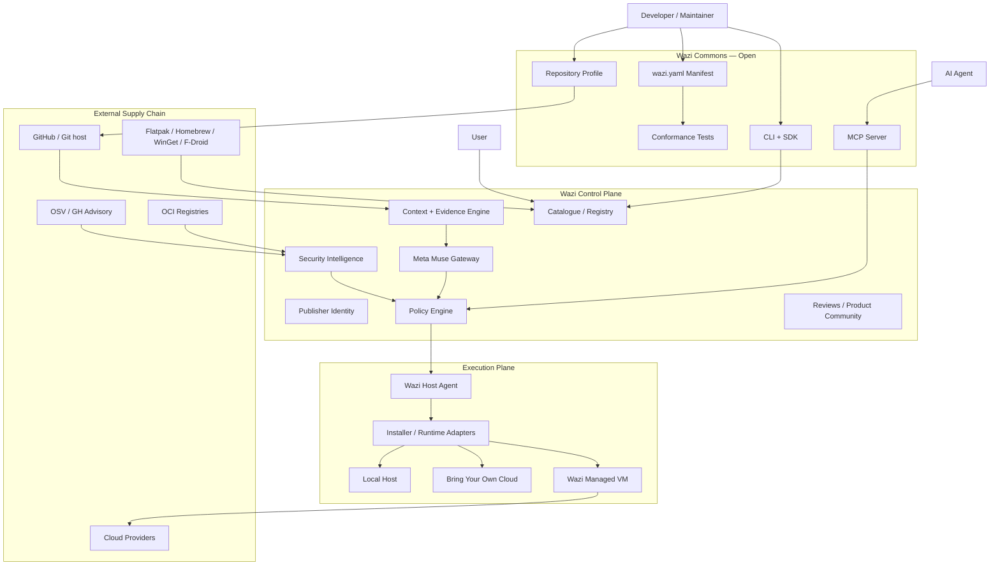
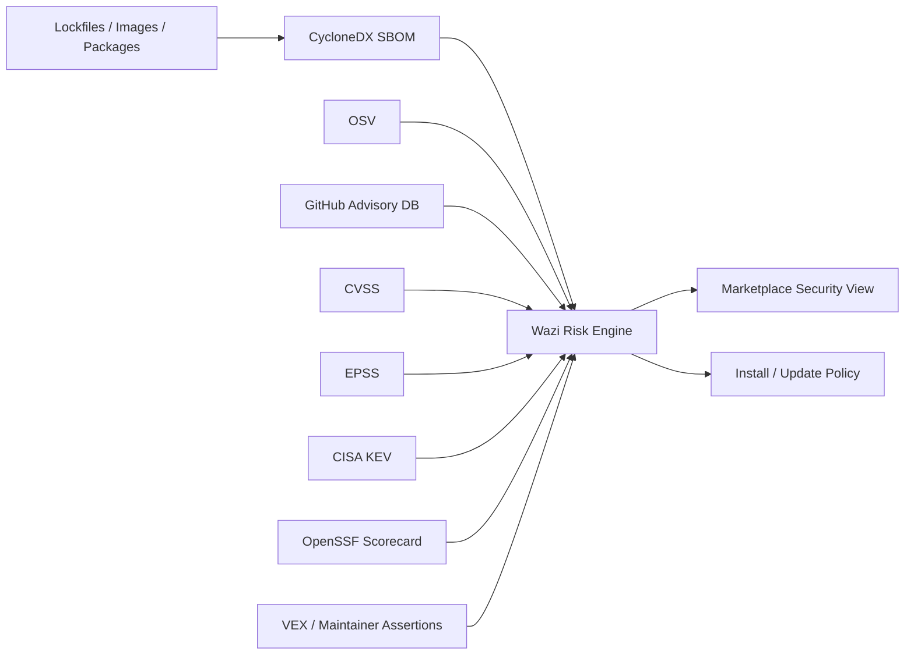
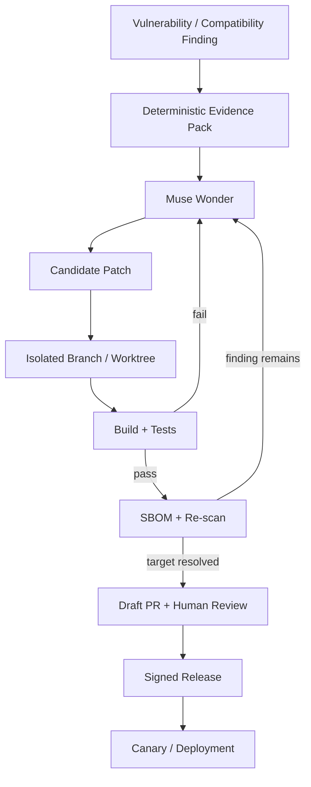
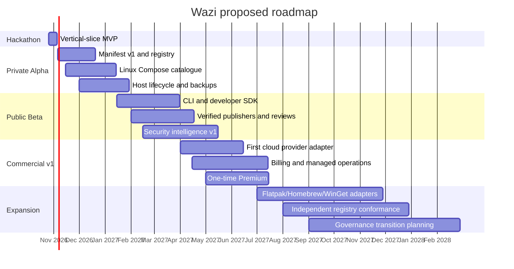

# Wazi: Open Software Distribution, Repository Standard, AI-Assisted Maintenance and Managed Compute

> **Imported completed research report | 21 October 2026 | planning, not implemented.** This is the original detailed Wazi research synthesis, adapted from its deep-research viewer into a GitHub-readable document. Source-reference widgets used in the research viewer are not portable to GitHub; consult the primary-source index below and recheck time-sensitive claims. See [the hackathon execution plan](HACKATHON_2026_EXECUTION_PLAN.md), [installer research](WAZI_INSTALLER_AND_STORE_BRIDGE.md), and [preview/insider spec](PREVIEW_AND_INSIDER_PROGRAM.md) for subsequent scope additions and current execution decisions.


**Research and product architecture report for Bera-Corp/Wazi**
**Hackathon context:** Meta Global AI Developer Hackathon, Indie Developer Track
**Research date:** 21 October 2026
**Language:** en-GB

## Executive summary and strategic assumptions

Wazi should not be positioned narrowly as an “open-source app store”. That framing understates the product and puts it into direct comparison with mature distribution systems that already solve substantial parts of application packaging.

The stronger proposition is:

> **Wazi is an open application standard and trusted software lifecycle platform that turns repositories into applications people and AI agents can discover, understand, verify, install, deploy and maintain.**

The platform should span four connected but separable functions:

| Wazi surface | Primary job | Business model |
|---|---|---|
| **Wazi Commons** | Open manifest, repository profiles, SDK, CLI, conformance tests and installation/deployment interfaces | Open source |
| **Wazi Store** | Discovery, publisher verification, reviews, application health, donations and installation UX | Free marketplace + optional one-time Premium |
| **Wazi Guardian** | SBOMs, vulnerability intelligence, provenance, permission analysis and AI-assisted remediation | Core security free; advanced managed operations potentially paid |
| **Wazi Cloud** | Single-tenant-per-customer VM provisioning, deployment lifecycle, backups and optional metered AI | Recurring because underlying compute/API costs recur |

This is consistent with the architecture already present in the private `Bera-Corp/wazi` repository. The existing project correctly defines Wazi around deterministic manifests, controlled packaging, typed execution, policy gates, signed manifests, host compatibility, rollback and a strict prohibition on giving an AI model a generic privileged shell. The current architecture also already separates the web client, control plane, context engine, policy engine, planner gateway and mutually authenticated host agent. Those principles should survive the broader product expansion rather than being replaced by a more permissive “install anything with AI” design.

The central strategic insight is that **Wazi need not replace Flatpak, Flathub, Homebrew, WinGet, F-Droid, Docker or GitHub**. It should become an interoperability and trust layer over them. Flatpak already provides sandboxed Linux application execution; Flathub provides review and publisher verification; Homebrew and WinGet provide mature host-native package distribution; F-Droid demonstrates source-oriented distribution and reproducible-build discipline; Docker Compose describes multi-service applications. Wazi's missing layer is a common application identity, security and permission vocabulary, cross-target manifest, lifecycle model, marketplace experience, agent API and managed-compute option. The product should also avoid claiming that abandoned AI-generated repositories are causing GitHub outages. GitHub itself reported in April 2026 that it had moved from planning for 10× capacity to designing for 30× current scale and explicitly identified sharp growth in agentic workflows, repository creation, pull requests, API activity and automation. GitHub also documented concrete incident-specific causes. That supports the thesis that software creation is changing dramatically, but not the claim that abandoned repositories directly cause outages. Wazi's legitimate contribution is to separate **source hosting** from **product distribution and lifecycle operations**, cache validated release metadata, avoid needless polling, and give users a product-oriented view of projects rather than adding another source-control system.

For the Meta hackathon, the winning version is smaller than the ultimate vision. The demonstration should be:

> **GitHub repository → Fleet repository audit → Wazi manifest → SBOM and vulnerability finding → Muse Wonder remediation → tests and rescan → human approval → private Linux deployment → Wazi marketplace listing → MCP inspection.**

That directly matches the Indie track's published criteria—creativity, technical ambition and whether the project actually works—and fits the “Push the Frontier” software theme. The event runs from 26 October to 4 November 2026, uses Meta models including Muse Wonder through Meta Model API, and has a US$1 million total prize pool across Indie and Startup tracks. Meta's current documentation lists `muse-wonder-1.0` on Model API with a one-million-token context window and prices of US$4 per million input tokens, US$0.20 cached input and US$20 output. It is explicitly designed for coding and long-running agentic work. Meta Model API also supports developer-defined typed tool calling while leaving actual tool execution in the developer's application, which maps cleanly onto Wazi's proposed policy-gated architecture. **The critical design rule is therefore: AI proposes; deterministic systems establish facts; policies authorise; tests verify; humans retain authority over high-impact actions.**

**Explicit assumptions used throughout this report:**

| Assumption | Status |
|---|---|
| Wazi remains a Bera-Corp project during the hackathon | Assumed |
| Exact commercial prices are not decided | Open |
| Exact cloud-provider partnerships are not signed | Open |
| First production target remains Linux x86_64 + Docker Compose | Existing Wazi direction |
| “Private VM” means a VM dedicated to one Wazi customer/tenant, not necessarily a dedicated physical host | Proposed definition |
| Windows/macOS/Android native application management is later-stage | Proposed |
| Wazi security grades are advisory, not security warranties | Proposed |
| AI-generated fixes require review during MVP | Proposed |
| Wazi's open-source licence remains undecided at present | Confirmed by current repository |
| Exact Meta hackathon prize-category mechanics beyond the published Indie/Startup tracks remain dependent on the final Official Rules | Official Rules were still pending as of the event page's latest publication |

## Vision, positioning and the ecosystem gap

Wazi's long-term opportunity is created by a widening asymmetry: creating source code is becoming cheaper, while **turning code into maintained, trustworthy, installable software remains operationally expensive**.

GitHub's own infrastructure discussion illustrates the scale of the shift. The company said agentic development had sharply accelerated since late December 2025 and that repository creation, pull-request volume, APIs and automation were all growing quickly. More code therefore does not automatically imply more usable products.

Wazi should deliberately define three separate concepts:

**Repository:** source, history, collaboration and development process.

**Application:** a versioned release that has an identity, requirements, permissions, security evidence and known lifecycle operations.

**Deployment:** one concrete installed instance of an application on a device or server.

GitHub remains excellent at the first. Wazi should concentrate on the second and third.

### Existing projects and the gap Wazi fills

| Existing project | What it already does well | What Wazi should reuse | Gap Wazi can fill |
|---|---|---|---|
| **Flatpak** | Sandboxed Linux applications with explicitly declared host permissions; default sandbox access is deliberately narrow. | Linux desktop adapter and permission evidence | Cross-platform identity, cloud deployments, marketplace health, repository standard and agent API |
| **Flathub** | Curated Flatpak distribution, application requirements, review and publisher verification tied to domains/repository ownership. | Verification concepts and Linux catalogue adapter | Unified local/server/cloud lifecycle and cross-package metadata |
| **Homebrew** | Formulae for OSS command-line software and casks for native applications, with canonical sources, hashes, audits and tests. | macOS/Linux package adapter | Consumer-grade permissions/security profile, application reviews and managed compute |
| **WinGet** | YAML manifests, public community manifest repository and automated/manual package validation. | Windows installer adapter and metadata import | Cross-platform lifecycle and Wazi-specific trust/deployment layer |
| **F-Droid** | FLOSS Android distribution, source/build review, maintenance requirements and strong build-transparency principles. | Android metadata/security ideas | Multi-device standard and non-Android distribution |
| **Docker Compose** | Declarative services, networks, volumes, configs and secrets for multi-container applications. | First-class Wazi deployment backend | User-facing discovery, health rating, release verification and multi-provider provisioning |
| **OCI Distribution** | Standardised storage and distribution primitives for content-addressed artefacts. | Registry substrate for manifests, SBOMs and attestations | End-user application semantics above generic artefacts |
| **Dependabot** | Dependency alerts and automated vulnerable-dependency update workflows. | GitHub integration/precedent | Cross-host app status, deployment validation and model-assisted non-trivial remediation |
| **GitHub Agentic Autofix** | Explores a repository, produces and validates potential security fixes, then opens draft PRs; GitHub explicitly still advises review/testing. | Pattern for safe AI remediation | Works as part of Wazi's broader repository → distribution → deployed-instance lifecycle |
| **OSV** | Package/version/commit-addressable open vulnerability API. | Primary vulnerability correlation feed | Normalised application-level interpretation and user-facing risk |
| **Sigstore** | Identity-based artefact signing with ephemeral keys, Fulcio certificates and Rekor transparency logging. | Release/manifests/attestation verification | Bind verified provenance into Wazi application trust and install policy |
| **OpenSSF Scorecard** | Automated repository security-health checks scored by practice. | Repository-health input | Combine repository hygiene with runtime permissions, vulnerabilities and release provenance |

The table exposes the key strategy: **Wazi should orchestrate and normalise existing standards rather than fight them.**

A mature Wazi listing could therefore represent one logical application with several delivery targets:

```text
org.example.paperapp
├── Windows → WinGet / MSIX
├── macOS → Homebrew Cask / signed PKG
├── Linux → Flatpak
├── Server → OCI image + Docker Compose
└── Cloud → OCI/Compose + Wazi infrastructure profile
```

Each target has a different package and security model, but the user sees one product identity.

### Positioning by stakeholder

| Stakeholder | Current problem | Wazi proposition |
|---|---|---|
| End user | “I found a project but do not know whether it works, is safe, or how to install it.” | Discover, understand, verify, install and maintain |
| Indie developer | “I can build code but packaging, DevOps, security and marketing are separate disciplines.” | Bootstrap, package, validate, distribute, receive reviews and maintain |
| OSS maintainer | “Users file poor bug reports and dependencies require constant attention.” | Structured diagnostics, vulnerability intelligence and controlled remediation PRs |
| AI coding agent | “Every repository and deployment environment is structured differently.” | Predictable repository profile, manifest and MCP tools |
| Enterprise | “We need governance rather than arbitrary agent autonomy.” | Policy profiles, approvals, audit and evidence |
| Non-technical self-hoster | “Docker commands, TLS, backups and upgrades are still infrastructure work.” | App-store-style private deployment |
| Cloud user | “I want a service to run continuously without maintaining a home server.” | Optional dedicated Wazi-managed VM |

**Wazi's strongest initial category is self-hosted applications and developer/AI tools**, because they expose the installation pain most clearly and align with the current repository's Docker Compose architecture. Expanding immediately into every Windows/macOS/Linux native package would add adapter complexity without strengthening the hackathon demonstration. The existing repo already deliberately limits MVP scope to curated self-hosted applications rather than arbitrary repository execution.

The store should also create better product-level signals than source-code stars. A star can represent interest; it does not prove a successful installation, compatible environment, reliable update or satisfied user. Wazi should therefore track **successful verified installations**, **installation success rate**, **version adoption**, **review ratings**, **maintenance state** and **security evidence** separately rather than hiding them inside one popularity number.

## Architecture, repository standard and developer interfaces

Wazi should have a deliberately layered architecture in which an open specification can survive even if the commercial marketplace disappears.

**Repository-ready Mermaid architecture:**



This extends, rather than contradicts, Wazi's current separation of control, context, policy and execution.

**Application identity and manifest**

The repository should rename the earlier conceptual `openapp.yaml` to something Wazi-native, preferably:

```text
wazi.yaml
```

This is the release/deployment contract. Repository engineering policy should live separately in:

```text
.wazi/repository.yaml
```

That separation is important. A mature open-source project should be distributable through Wazi without being forced to adopt Wazi's preferred Git branch structure.

A proposed `wazi.yaml`:

```yaml
schema_version: "1.0"

application:
 id: "io.github.example.paperapp"
 name: "Paper App"
 version: "2.4.1"
 description: "Self-hosted document management."
 source:
 repository: "https://github.com/example/paperapp"
 revision: "v2.4.1"
 licence:
 spdx: "GPL-3.0-or-later"

publisher:
 identity: "github:example"
 verification:
 required: true

artifacts:
 - id: "server-amd64"
 type: "oci"
 image: "ghcr.io/example/paperapp@sha256:EXAMPLE_DIGEST"
 platforms:
 - os: "linux"
 architecture: "amd64"

 - id: "linux-desktop"
 type: "flatpak"
 ref: "io.github.example.PaperApp"

runtime:
 default: "compose"
 compose:
 file: "deploy/compose.yaml"
 services:
 - "app"
 - "database"

resources:
 minimum:
 cpu_cores: 1
 memory_mib: 1024
 storage_gib: 10
 recommended:
 cpu_cores: 2
 memory_mib: 2048
 storage_gib: 25

permissions:
 network:
 outbound:
 required: true
 inbound:
 - protocol: "tcp"
 container_port: 8080
 exposure: "reverse-proxy"
 filesystem:
 persistent:
 - id: "app-data"
 path: "/var/lib/paperapp"
 access: "read-write"
 host_arbitrary_access: false
 devices: []
 privileged_execution: false
 host_pid_namespace: false
 docker_socket: false

secrets:
 - id: "database-password"
 generate: true
 expose_to_model: false
 - id: "app-secret"
 generate: true
 expose_to_model: false

health:
 checks:
 - type: "http"
 endpoint: "/health"
 expected_status: 200
 timeout_seconds: 5

lifecycle:
 backup:
 supported: true
 paths:
 - "app-data"
 restore:
 verification_required: true
 upgrade:
 strategy: "stop-backup-migrate-start-verify"
 rollback:
 supported: true
 uninstall:
 preserve_user_data_by_default: true

security:
 sbom:
 format: "cyclonedx-json"
 required: true
 signatures:
 sigstore_required: true
 provenance:
 slsa_required_level: 1
 vulnerability_policy:
 block_known_exploited: true
 warn_cvss_at_or_above: 7.0

distribution:
 channels:
 - "stable"
 install_targets:
 - "local-linux"
 - "byo-vps"
 - "wazi-cloud"

store:
 category: "productivity"
 review_status: "pending"
 donations:
 enabled: true
```

The manifest should define **requirements and intentions**, not provider-specific shell commands. Docker Compose itself already provides declarative service/network/volume/secret semantics, so Wazi should reference or transform those semantics instead of inventing another container orchestrator. Where possible, manifest releases, SBOMs, signatures and provenance should be distributable as OCI artefacts. OCI gives Wazi a standard registry substrate rather than requiring a bespoke global binary transport protocol. **Repository profile**

A proposed `.wazi/repository.yaml`:

```yaml
schema_version: "1.0"

profile: "solo"

repository:
 default_branch: "main"
 task_branches:
 pattern: "feat/*|fix/*|chore/*"
 delete_merged_branches: true

commits:
 convention: "conventional-commits"
 signed:
 required_for_release: true

pull_requests:
 required_for:
 - "release"
 - "security-sensitive"
 approvals:
 default: 0
 security_sensitive: 1

testing:
 required_commands:
 - "npm test"
 - "npm run build"
 production_change_requires_test_change: true

ci:
 provider: "github-actions"
 required_checks:
 - "test"
 - "build"
 - "wazi-validate"
 - "wazi-security"

security:
 dependency_updates: true
 secret_scanning_expected: true
 code_scanning_expected: true

agents:
 instructions: "AGENTS.md"
 write_policy: "review-required"
 prohibited:
 - "direct-push-main"
 - "read-production-secrets"
 - "disable-security-checks"

release:
 manifest: "wazi.yaml"
```

Wazi should use **AGENTS.md rather than creating another agent-instruction filename**. AGENTS.md is explicitly intended as a predictable, open “README for agents”, allows nested files whose closest instructions take precedence, and deliberately imposes no fixed schema. A Wazi-generated `AGENTS.md` could be concise:

```markdown
# AGENTS.md

## Repository purpose
This repository produces the Paper App application.

## Setup
- Install dependencies with `pnpm install`.
- Do not change lockfiles unless dependency changes are intentional.

## Validation
Before completing a code change:
1. Run `pnpm test`.
2. Run `pnpm build`.
3. Run `wazi validate`.
4. Run `wazi scan`.

## Repository policy
- Do not push directly to `main`.
- Use a task branch.
- Do not weaken tests to make a change pass.
- Do not disable security checks.
- Never read or print production secret values.

## Wazi release contract
- `wazi.yaml` describes distributed application behaviour.
- Permission changes require explicit review.
- New privileged capabilities require maintainer approval.

## Security changes
- Prefer the smallest compatible remediation.
- Generated security fixes must be delivered as pull requests.
- Re-scan the resolved dependency graph after remediation.
```

**Profiles should scale without forcing enterprise workflow onto individuals:**

| Profile | Solo | Team | Enterprise |
|---|---|---|---|
| Default branch | `main` | `main` | Configurable |
| Short-lived branches | Recommended | Required for code changes | Policy-defined |
| PR approval | Optional except sensitive changes | Required | Required with role rules |
| CODEOWNERS | Optional | Recommended | Required for protected areas |
| CI | Basic build/test/security | Required | Required + centrally governed |
| Signed releases | Required | Required | Required |
| Wazi manifest | Required to publish | Required | Required |
| Agent write access | PR-only | Policy-scoped | Fine-grained identity + approval |
| Audit retention | Local/basic | Central | Tamper-evident |
| Fleet integration | Repo Doctor + Test-First optional | Recommended | Full policy/governance options |

GitHub rulesets already support controls such as mandatory pull requests, status checks and signed commits, so Wazi's profiles should generate or audit those controls instead of replacing them with proprietary equivalents. CODEOWNERS and reusable Actions workflows can likewise remain native GitHub constructs. **Fleet Control Plane integration: reuse versus new work**

Fleet is not merely historical inspiration here. It already contains exactly the kind of policy primitives Wazi needs.

| Capability | Fleet already provides | Wazi decision |
|---|---|---|
| Repository settings audit | Fleet Repo Doctor | **Reuse** |
| Test-first policy | Fleet Test-First Gate | **Reuse** |
| Safe branch migration | Fleet Safe Branch Migrator | **Reuse** |
| Flexible branch topology | Repo Doctor explicitly supports trunk-only, GitFlow or omitted branch requirements | **Reuse** |
| Deterministic bootstrap | Fleet Bootstrap | **Reuse** |
| Versioned release bundle/hashes | Fleet distribution tooling | **Reuse concepts and code where cleanly packageable** |
| AI orchestration | Fleet Blueprints | Optional adapter |
| Marketplace identity | No | **New in Wazi** |
| Cross-package app manifest | No | **New in Wazi** |
| App security grade | No | **New in Wazi** |
| Installer/cloud adapters | No | **New in Wazi** |
| Reviews/ratings | No | **New in Wazi** |
| MCP application/deployment API | Wazi-specific domain not present | **New in Wazi** |
| Cloud billing | No | **New in Wazi** |

Fleet's current standalone architecture explicitly treats the command-line tools as product boundaries and GitHub Actions/Fleet Blueprints as adapters; it also deliberately does not require consumers to adopt Fleet's own branch model. That makes the components suitable for Wazi's Solo/Team/Enterprise profiles.

Its distribution architecture also already solves a valuable reproducibility problem: a canonical bootstrap source generates synchronised bootstrap, template, Blueprint and Agent Skill distributions with checksums and a release manifest rather than maintaining divergent copies. Wazi should reuse that philosophy for its manifest schema, CLI templates and SDKs.

**Installer/adapter model**

The Wazi core should never need to understand every package format internally. It should expose a typed adapter interface:

```text
detect()
preflight()
plan()
approve()
install()
verify()
update()
backup()
restore()
rollback()
uninstall()
collect_evidence()
```

| Adapter | Initial priority | Execution mechanism |
|---|---:|---|
| Docker Compose | MVP | Wazi host agent |
| OCI image | MVP | Registry + container runtime |
| Existing Linux VPS | MVP | Paired host agent |
| DigitalOcean VM | Post-hackathon | Cloud API |
| Hetzner Cloud VM | Post-hackathon | Cloud API |
| AWS Lightsail | Post-hackathon | Cloud API |
| Flatpak | Later | Flatpak CLI/API |
| Homebrew | Later | `brew` adapter |
| WinGet | Later | `winget` adapter |
| F-Droid/Android | Later | Platform-authorised Android workflow |

**Developer CLI**

```text
wazi init
wazi adopt
wazi doctor
wazi profile show
wazi profile set solo|team|enterprise

wazi manifest generate
wazi manifest validate
wazi permissions inspect
wazi sbom generate
wazi scan
wazi grade

wazi pack
wazi publish
wazi verify
wazi search <query>
wazi inspect <app-id>

wazi install <app-id>
wazi deploy <app-id>
wazi status
wazi update
wazi backup
wazi restore
wazi rollback
wazi uninstall

wazi repo remediate
wazi repo fix --advisory <id>
wazi mcp serve
```

The ergonomic entry point for a new project can mirror modern framework bootstrapping without pretending Wazi is itself an application framework:

```bash
npx create-wazi-app my-project
```

For an existing repository:

```bash
npx @wazi/cli adopt
```

`adopt` should inspect first and generate a migration proposal rather than overwrite existing CI or policies.

**MCP server**

Wazi should implement the current MCP HTTP model rather than a custom “agent API”. MCP's July 2026 specification moved towards stateless request/response operation, supports `POST /mcp`, and identifies tool invocations through `tools/call`; the specification also hardened OAuth issuer handling and agent identity/authorisation. | MCP tool | Purpose | Suggested scope | Side effect |
|---|---|---|---:|
| `wazi.search` | Search public catalogue | `catalog:read` | No |
| `wazi.inspect` | Retrieve app manifest, grade, permissions | `catalog:read` | No |
| `wazi.repo.audit` | Run Fleet/Wazi repository checks | `repo:read` | No |
| `wazi.manifest.generate` | Generate draft manifest | `repo:read` | No |
| `wazi.manifest.validate` | Validate schema/policy | `repo:read` | No |
| `wazi.security.scan` | Produce vulnerability report | `repo:read` | No |
| `wazi.remediation.plan` | Ask Muse for a bounded remediation | `repo:read` | No |
| `wazi.remediation.create_pr` | Push branch and open draft PR | `repo:write` | Yes |
| `wazi.deployment.plan` | Produce deployment/cost plan | `deploy:plan` | No |
| `wazi.deployment.apply` | Execute an approved plan | `deploy:write` + approval | Yes |
| `wazi.deployment.status` | Health/evidence query | `deploy:read` | No |
| `wazi.deployment.backup` | Trigger backup | `deploy:write` | Yes |
| `wazi.deployment.rollback` | Roll back an instance | `deploy:write` + approval | Yes |
| `wazi.cloud.provision` | Create billable infrastructure | `cloud:spend` + explicit approval | Yes |
| `wazi.cloud.destroy` | Destroy infrastructure | `cloud:write` + destructive approval | Yes |

Every side-effecting MCP call should carry an idempotency key, principal identity, tenant, target, policy decision and immutable audit ID. `cloud.provision`, destructive operations and new public-network exposure should require an approval artefact generated outside the model's own reasoning loop.

## Security, permissions and AI-assisted maintenance

Wazi cannot credibly become an application distributor unless **trust is a first-order product surface rather than a badge added later**.

The present Wazi threat model already covers malicious upstream repositories, compromised dependencies, prompt injection in documentation/logs, tenant isolation, compromised hosts/accounts and insider abuse. Its existing controls—pinned image digests, SBOMs, isolated tests, signed/revocable manifests, typed capabilities, secret exclusion and stop-on-stale-or-contradictory context—are the right baseline.

### Vulnerability intelligence

Wazi should **not build another primary CVE database**. It should construct an intelligence and correlation layer.



OSV can directly match packages and versions or Git commits, making it suitable for the first hackathon integration. GitHub's Advisory Database adds GitHub-reviewed and unreviewed vulnerability information and malware advisories. CycloneDX should be Wazi's preferred SBOM representation. It is an established BOM standard supporting software component inventories and broader supply-chain data. The scoring signals should remain semantically distinct:

- **CVSS** expresses vulnerability characteristics and severity on a 0–10 scale; version 4.0 separates Base, Threat, Environmental and Supplemental metrics. - **EPSS** estimates the probability of a CVE being exploited in the wild within the next 30 days and updates daily; FIRST explicitly warns that EPSS is not itself a complete risk score. - **OpenSSF Scorecard** describes repository/project security practices and should therefore be treated as one input into supply-chain health, not evidence that an application is vulnerability-free. The marketplace should distinguish:

```text
No known vulnerabilities found
≠
Application is safe
```

and:

```text
No scan available
≠
No vulnerabilities
```

The UI should explicitly report `scanned`, `partially scanned`, `stale`, `unsupported` and `unknown`.

### Artefact integrity and provenance

Sigstore can give Wazi identity-bound signing: its keyless flow uses ephemeral keys, OIDC identity, short-lived Fulcio certificates and Rekor transparency logging. Sigstore itself distributes its trust root through TUF. SLSA gives Wazi a common vocabulary for build provenance and progressively stronger build guarantees; the current specification is v1.2. TUF contributes a different security property: resilience of update metadata against rollback, freeze, mix-and-match and key-compromise scenarios. These are complementary:

| Mechanism | Wazi use |
|---|---|
| CycloneDX | “What components are in this release?” |
| OSV/GHSA | “Are those components associated with known vulnerabilities?” |
| CVSS | “How severe is the vulnerability?” |
| EPSS | “How likely is observed exploitation soon?” |
| Sigstore | “Who/what identity signed this artefact?” |
| SLSA | “How was the artefact built, with what provenance?” |
| TUF concepts | “Can update metadata resist rollback/freeze/key compromise?” |
| OpenSSF Scorecard | “What security practices does the upstream repository exhibit?” |

### Proposed Wazi security grade

A single grade is useful for consumer comprehension but dangerous if opaque. The score therefore needs a published rubric plus visible component scores.

**Provisional rubric — not yet a security certification:**

| Dimension | Weight | Full-credit evidence | Major deduction |
|---|---:|---|---|
| Known vulnerability exposure | 30% | No applicable unresolved high-risk findings; fresh SBOM/scan | Critical/high exploitable findings, especially no fix |
| Release integrity and provenance | 25% | Digest pinned, verified signature, provenance, fresh metadata | Unsigned/unpinned artefact or identity mismatch |
| Runtime privilege | 20% | Non-root, narrow FS/network/device permissions | Privileged container, Docker socket, host namespace or broad host mounts |
| Repository/build hygiene | 15% | Protected releases, pinned CI, tests, Scorecard evidence | Weak branch/release control or risky CI |
| Maintenance and response | 10% | Supported release, recent security response, supported upgrade/rollback | Explicitly archived or stale security issues |

| Wazi grade | Score | Interpretation |
|---|---:|---|
| A | 90–100 | Strong evidence under the current policy |
| B | 80–89 | Good posture with limited material concerns |
| C | 70–79 | Usable with notable cautions |
| D | 55–69 | Elevated risk; user should inspect findings |
| E | <55 | Significant deficiencies |
| U | N/A | Insufficient or stale evidence |
| **Blocked** | Override | Violates a hard installation policy |

Hard-policy overrides should matter more than arithmetic. A revoked manifest, failed signature verification, artefact digest mismatch or explicitly forbidden privileged capability should produce **Blocked**, not “C because the other categories were good”.

The security page should show both the Wazi grade and the underlying CVSS/EPSS/advisory evidence so the score never becomes an unverifiable proprietary judgement.

### Permission model

Use one cross-platform vocabulary but represent enforcement honestly:

```yaml
permissions:
 network:
 outbound:
 mode: required
 inbound:
 mode: optional
 filesystem:
 home:
 mode: none
 user_selected:
 mode: read-only
 persistent_app_data:
 mode: read-write
 hardware:
 camera: optional
 microphone: none
 host:
 privileged_execution: false
 process_namespace: false
 container_runtime_socket: false
```

Every permission presented to the user needs one of four labels:

**Declared** — upstream says it needs this.

**Detected** — Wazi observed this behaviour/configuration.

**Enforced** — the platform actually prevents undeclared access.

**Not enforceable** — Wazi can disclose it but cannot safely revoke it.

That distinction is essential because operating systems differ substantially.

| Target | Wazi permission enforcement capability | Correct UX |
|---|---|---|
| Flatpak | Strong sandbox baseline and explicit grants. | Real toggles where supported |
| Wazi Docker/VM | Strong control over mounts, networks, capabilities and execution policy; rootless Docker can reduce daemon/container privilege. | Real Wazi-controlled policy |
| Android | OS controls install-time, runtime and special permissions. | Reflect native permission state |
| macOS sandboxed app | Kernel-enforced App Sandbox and entitlements govern access. | Inspect and explain entitlements |
| macOS arbitrary unsandboxed app | Wazi cannot retroactively turn it into a fully sandboxed App Store app | Disclosure rather than fake toggle |
| Windows AppContainer/MSIX | AppContainer can isolate processes and constrain access via declared capabilities. | Real controls for compatible apps |
| Traditional unrestricted Win32 installer | Generic Android-style per-capability revocation cannot be promised | Disclose requested/elevated access |
| Homebrew/legacy package | Installer may execute native operations outside a universal Wazi sandbox | Explain installer privileges |

### Muse-powered maintenance

Meta's strongest hackathon-aligned role is not “chat about the repository”. It is **constrained engineering work backed by deterministic tools**.

Muse Wonder is specifically documented for complex software engineering and long-horizon agent work and supports tool calling and structured output through Meta Model API. Meta's tool-calling interface returns a requested call while the application remains responsible for actually executing it, which lets Wazi interpose policy and validation before any mutation. The recommended maintenance pipeline is:



The evidence pack should contain the affected dependency, current version, advisory identifier, affected ranges, available fixed versions, relevant lockfile fragments, tests, `AGENTS.md`, Wazi repository policy and only the minimum source context necessary.

It should not contain production secrets.

The model's remit can expand by maintenance class:

| Maintenance class | MVP behaviour | Later behaviour |
|---|---|---|
| Patch dependency upgrade | Draft PR | Auto-PR under policy |
| Lockfile refresh | Draft PR | Auto-PR |
| Manifest compatibility correction | Draft proposal | Auto-PR after isolated deployment test |
| Simple API deprecation | Draft PR | Auto-PR if tests comprehensive |
| Authentication/authorisation change | Human-led | Human approval always |
| Database migration | Human-led | Human approval + backup/restore evidence |
| Privilege expansion | Block until explicit review | Explicit security approval |
| Destructive data migration | Never autonomous | Checkpoint + multiple policy gates |

GitHub's own Agentic Autofix provides useful precedent: it explores a repository, proposes and validates a fix, opens a draft pull request, and still instructs maintainers to review and test the generated change. Wazi should preserve that discipline while extending the validation from “does this fix source-code security?” to “can this release still package, install, operate and roll back?”

## Managed cloud, monetisation and governance

Wazi Cloud should exist because some users do not want the application running on their laptop, NAS or home server. This is a legitimate recurring product because compute, storage, bandwidth, backups and API inference have continuing costs.

### Private VM model

The user should see three deployment modes:

| Mode | Infrastructure owner | Wazi recurring infrastructure charge |
|---|---|---:|
| **Local** | User | None |
| **Bring Your Own Server/Cloud** | User | None for raw compute; optional management fee |
| **Wazi Cloud** | Wazi/partner billing relationship | Provider cost + surcharge + optional management |

A “private VM” should mean **one customer is allocated one logical virtual machine instance**. It does not imply a dedicated physical machine; the cloud provider may run several VMs on one hypervisor host. Wazi should never market ordinary VM tenancy as physical hardware isolation.

Provisioning should create:

```text
Customer
 |
Wazi Control Plane
 |
Provider Adapter
 |
Dedicated Customer VM
 |-- Wazi Host Agent
 |-- rootless/container runtime where practical
 |-- reverse proxy
 |-- application containers
 |-- encrypted application volume
 |-- backup target
 `-- narrow outbound control-plane channel
```

The control plane should issue deployment plans, but the local host agent should retain the current Wazi principle of exposing typed capabilities rather than a generic root shell.

### Provider strategy

No exclusive partnership is required for the MVP. Build a provider interface first.

| Candidate | Relevant characteristics | Wazi use |
|---|---|---|
| **DigitalOcean** | Droplets are Linux VMs; its API can create/list/delete them. Current billing is usage-based and powered-off bundled Droplets remain billable until destroyed. | Strong first commercial adapter |
| **Hetzner Cloud** | Hourly billing with monthly caps; existing servers continue to accrue cost while turned off. | Cost-sensitive European option |
| **AWS Lightsail** | Simple fixed instance bundles billed hourly up to monthly cap; current Linux plans begin at US$5/month and stopped instances continue accruing cost until deleted. | Familiar AWS-backed option |
| **User-provided VPS** | No Wazi infrastructure resale requirement | Best early-stage economics and lowest billing risk |

A partnership should eventually be negotiated around API provisioning, referral/reseller economics, regional availability, abuse handling and credit limits. It should not be a dependency for the hackathon.

### The five-per-cent surcharge

A transparent 5% surcharge is attractive but **cannot by itself support a high-touch managed service at small VM sizes**.

For example:

| Provider charge | 5% surcharge | User infrastructure subtotal | Wazi gross surcharge before costs |
|---:|---:|---:|---:|
| US$5.00 | US$0.25 | US$5.25 | US$0.25 |
| US$7.00 | US$0.35 | US$7.35 | US$0.35 |
| US$12.00 | US$0.60 | US$12.60 | US$0.60 |
| US$24.00 | US$1.20 | US$25.20 | US$1.20 |

That margin is before payment processing, VAT/sales tax handling, fraud, support, failed payments, monitoring, control-plane infrastructure and backup metadata.

The cleaner model is:

> **Provider cost + 5% infrastructure handling + explicit managed-service fee where Wazi assumes operational responsibility.**

Users bringing their own cloud account can avoid the infrastructure surcharge and pay only for optional Wazi management.

### Proposed commercial structure

Prices below are **planning assumptions, not final prices**.

| Product | Suggested pricing logic | Recurring? | Why |
|---|---|---:|---|
| Wazi Commons | Free/open source | No | Ecosystem standard |
| Wazi Store basic | Free | No | Discovery flywheel |
| Wazi Desktop/Local Premium | £/$ equivalent of roughly US$39–59 once | No | Local convenience features have no necessary per-user monthly compute cost |
| Developer donations | User-selected one-time amount | No | Direct creator support |
| Wazi Cloud infrastructure | Provider charge + 5% | Yes | Underlying VM recurs |
| Managed operations | Example US$4–10/VM/month depending scope | Yes | Monitoring/control-plane/support recurs |
| Wazi-billed Meta/API inference | Provider API cost + 5% | Usage/monthly | API consumption recurs |
| Bring-your-own API key | Provider charges user | No Wazi model markup | User owns consumption relationship |
| Cloud backups beyond included allowance | Pass-through + disclosed margin | Yes | Storage recurs |
| Institutional perpetual client licence | One-time negotiated | No | Permanent local capabilities |
| Support incident pack | One-time | No | Alternative to forced support subscription |

The one-time Premium licence should not promise unlimited hosted inference, backups or managed servers, because those create indefinite marginal costs.

For AI accounts, distinguish **consumer subscriptions from API access**. For example, OpenAI currently treats ChatGPT and API billing as separate systems and explicitly states that API usage is billed separately from a ChatGPT subscription. Wazi should therefore support authorised API credentials/OAuth integrations rather than attempting to convert consumer web subscriptions into undocumented programmatic access.

Meta's current Model API pricing similarly makes metered cost explicit; Muse Wonder is presently US$4/M input tokens and US$20/M output tokens. That supports transparent pass-through AI billing.

### Billing risks

The main commercial risks are not computational:

| Risk | Consequence | Mitigation |
|---|---|---|
| VM exists but user thinks “off” means free | Unexpected bill | Display provider semantics and require explicit destroy action |
| Provider changes price | Margin compression | Dynamic provider price catalogue |
| Customer abuse | Provider account suspension | AUP, quotas, staged trust, provider abuse APIs |
| Failed customer payment | Wazi pays provider anyway | Pre-authorisation/deposit/credit limits |
| Chargeback | Infrastructure already consumed | Strong identity/risk controls |
| Egress/storage/backup overage | Surprise bill | Budgets and predicted-cost plan before provisioning |
| Orphaned VM | Persistent recurring cost | Reconciliation worker and inventory ledger |
| Tax/VAT | Compliance liability | Merchant-of-record or tax platform analysis before broad launch |
| Currency movement | Surcharge disappears | Bill in provider currency or periodically update FX |
| Customer data loss | High liability | Restore verification, explicit retention and backup policies |
| Partner outage | User blames Wazi | Status mapping, multi-provider roadmap, transparent responsibility boundaries |

### Donations

Donations should be attached to verified publishers or maintainers. Wazi should avoid turning donations into a hidden marketplace commission. A sensible starting policy is:

```text
Donation amount
– payment processor fee
= maintainer proceeds
```

A voluntary Wazi contribution can be offered separately.

This creates stronger alignment with the open-source community and reduces the perception that Wazi is commercialising someone else's free work.

### Foundation versus commercial entity

The open standard requires neutral governance eventually, but creating a foundation before adoption would be premature.

The staged structure should be:

```text
2026–early 2027
Bera-Corp stewards Wazi openly with public governance rules

↓ sufficient external maintainers/adopters

Wazi Foundation / Commons body
owns specification, conformance, trademark policy and open governance

+
Wazi commercial company
operates hosted marketplace, billing, managed compute and premium services
```

Recommended component licensing:

| Component | Proposed licence/status | Reason |
|---|---|---|
| `wazi.yaml` schema/specification | Apache-2.0 | Broad implementation rights |
| Repository profile specification | Apache-2.0 | Encourage adoption |
| CLI | Apache-2.0 | Essential ecosystem bootstrap |
| SDKs | Apache-2.0 | Low-friction integrations |
| MCP reference server | Apache-2.0 | Agent ecosystem adoption |
| Installer adapter interfaces | Apache-2.0 | Third-party adapter ecosystem |
| Reference adapters | Apache-2.0 where dependency-compatible | Encourage ports/providers |
| Host agent core | Apache-2.0 initially | User trust and auditability |
| Security grading specification | Open specification | Scores should be independently reproducible |
| Conformance test suite | Apache-2.0 | Independent store implementation |
| Marketplace frontend/backend | Proprietary or source-available commercial component | Commercial differentiation |
| Billing/provisioning brokerage | Proprietary service | Operational business layer |
| Premium UX modules | Commercial licence | One-time revenue |
| Wazi trademark/certification mark | Reserved | Prevent deceptive compatibility claims |

Apache-2.0 includes an explicit patent grant, which is useful for a standard intended for wide commercial and open-source implementation. AGPL remains a legitimate alternative for a networked control plane because it requires source availability for modified covered software served to users over a network, but that stronger reciprocity can create more adoption friction for vendors. The current Wazi repository already records Apache-2.0, AGPL-3.0 and an open-core structure as unresolved alternatives and states that no public licence has yet been selected. For the stated goal of making the core an international interoperability standard, **Apache-2.0 for the specification/core plus clearly separated commercial services is the strongest default recommendation**.

## Hackathon MVP, demo and marketing strategy

The official Meta event is ten days, from 26 October through 4 November 2026. The Indie track is judged on creativity, technical ambition and whether the project works. Muse Wonder is explicitly included among available Meta Model API models for the event. Do not spend ten days building ten half-functional subsystems. Build the core in three to five days, then use the rest of the event for testing, evidence, presentation and community validation.

### MVP architecture

For the hackathon only:

```text
Next.js web application
 |
 +-- GitHub App/OAuth
 |
 +-- Fleet Repo Doctor
 |
 +-- Wazi manifest generator
 |
 +-- CycloneDX-style dependency/SBOM pipeline
 |
 +-- OSV lookup
 |
 +-- Meta Model API / Muse Wonder
 |
 +-- Draft PR
 |
 +-- Docker Compose deployment on ONE Linux target
 |
 +-- Minimal Wazi MCP server
 |
 `-- PostgreSQL
```

A solo developer should resist rewriting the current Go-agent architecture during the hackathon. A production host agent can remain Go as the repository currently proposes, but for the demo the fastest stack is:

| Layer | Hackathon choice |
|---|---|
| Frontend | Next.js + TypeScript |
| UI | Tailwind + shadcn/ui |
| API | Next.js route handlers or small TypeScript service |
| Database | PostgreSQL, preferably managed for speed |
| Source integration | GitHub App |
| Repository governance | Existing Fleet Python CLIs |
| AI | Meta Model API `muse-wonder-1.0`; Spark for cheaper simple transformations if useful |
| Vulnerability source | OSV |
| SBOM | CycloneDX-compatible output |
| Packaging | Wazi YAML + Docker Compose |
| Deployment | One pre-provisioned Linux VM |
| MCP | Current TypeScript MCP SDK |
| Store | Same Next.js app |
| Billing | **Mock cost calculation only** |
| Provider provisioning | **Mock or single controlled provider integration only** |

Meta explicitly provides an OpenAI-SDK-compatible Model API pattern and typed function calls, reducing integration time. ### Five-day MVP build plan

| Day | Engineering objective | Concrete output | Demo gate |
|---|---|---|---|
| **Day 1** | Repository intake + Fleet | GitHub import, Repo Doctor results, Solo profile bootstrap, `AGENTS.md` | An authorised repo receives a structured Wazi repository report |
| **Day 2** | Manifest + security | Generate/validate `wazi.yaml`, dependency inventory, OSV findings, first risk view | Real known vulnerability maps to an exact package/version |
| **Day 3** | Muse remediation | Evidence packet → Muse Wonder → isolated patch → draft PR | Model creates bounded fix; tests run; target finding is re-scanned |
| **Day 4** | Deployment + MCP | Compose deployment to one VM, health status, `wazi.inspect`/`security.scan`/`deployment.status` MCP tools | Working app is remotely deployed and queryable by an agent |
| **Day 5** | Marketplace + polish | App page, security grade, permission summary, verified-install review, developer reply | Complete repo-to-user story works without manual hidden steps |

**Days six to ten of the event should be treated as validation/presentation time rather than another product rewrite.**

A practical remainder:

| Period | Work |
|---|---|
| Days 6–7 | Failure-path testing, auth boundaries, UX corrections |
| Day 8 | External testers and evidence collection |
| Day 9 | Final video and README |
| Day 10 | Submission, deployment stability, submission buffer |

### Hackathon acceptance criteria

| Requirement | Pass condition |
|---|---|
| Repository integration | User can authorise and import one real repository |
| Fleet reuse | Repo Doctor result appears inside Wazi |
| Repository standard | Wazi produces a valid profile + `AGENTS.md` |
| Manifest | `wazi.yaml` validates against a versioned schema |
| Security | At least one real advisory is detected against a controlled vulnerable dependency |
| Evidence | Advisory ID, affected component and version are shown |
| Muse | Muse receives only scoped evidence/code context and proposes a remediation |
| Isolation | AI changes occur outside protected `main` |
| Verification | Build/tests run after patch |
| Re-scan | Target finding disappears or is explicitly shown as unresolved |
| Human authority | PR/release requires approval |
| Deployment | Approved build runs on one Linux VM |
| Health | Wazi receives a successful health check |
| MCP | At least three tools can be invoked by an MCP client |
| Store | Application has a real detail page |
| Reviews | Successful demo installation can submit a “verified install” review |
| Reliability | Complete demonstration succeeds repeatedly from a reset state |
| Security | No production secret value enters model context |
| Honesty | Mock functionality is explicitly labelled mock |

The existing Wazi repository's stricter eventual quality goals—such as high first-attempt install success, backup/restore verification and no arbitrary shell execution—should remain post-hackathon engineering gates rather than being faked for the competition.

### Live demo script

The live demonstration should tell one story:

**Start:** Open an intentionally imperfect demonstration repository.

**Audit:** Wazi connects through GitHub and Fleet reports repository-policy health.

**Standardise:** Wazi shows the generated Solo profile, `AGENTS.md` and candidate `wazi.yaml`.

**Detect:** The security view reveals a real vulnerable dependency from OSV.

**Understand:** Show CVSS/advisory data and the user-facing explanation.

**Fix:** Muse Wonder receives the controlled context packet and prepares a minimal remediation.

**Verify:** Wazi runs tests, regenerates/re-evaluates the dependency state and demonstrates that the targeted finding has been resolved.

**Approve:** Open the actual draft PR and approve through the normal repository flow.

**Deploy:** Wazi installs the app on the demo VM through the Compose adapter.

**Operate:** Show the health status, resource/permission page and security grade.

**Agent:** Invoke `wazi.inspect` or `wazi.deployment.status` over MCP.

**User proof:** Show the installation recognised as eligible for a verified-install review.

This communicates substantially more technical depth than a chatbot generating YAML.

### User experience

A Wazi application page should separate popularity from trust:

```text
Paper App Publisher verified

★★★★☆ 4.6
128 verified-install reviews

14,382 successful installs
97.8% install success on supported targets

Security B
Maintenance Active
Last scan 2 hours ago
Latest version 2.4.1

Permissions
• Network outbound Required / Enforced
• Internet-facing port Optional / User approved
• Persistent app storage Required / Enforced
• Host filesystem None
• Privileged execution None

Known security findings
1 Medium · 0 High · 0 Critical

[Install locally]
[Deploy privately]
[View source]
[Support developer]
```

A **verified-install review** should mean exactly that: Wazi recorded a successful installation/deployment for that account and app release. It should not imply the user ran the application for weeks or that Wazi verified the reviewer's subjective claims.

Ratings should allow dimensions such as:

| Dimension | Example |
|---|---|
| Overall | 4/5 |
| Installation | 5/5 |
| Reliability | 4/5 |
| Documentation | 3/5 |
| Ease of use | 4/5 |

Developer replies can live on Wazi. Technical defects should normally continue into GitHub Issues or the maintainer's selected tracker.

A bug-report flow should therefore be:

```text
User: Report problem
 ↓
Wazi gathers app version + platform + non-sensitive diagnostics
 ↓
Redaction preview
 ↓
User edits description
 ↓
Maintainer-selected target
 ↓
GitHub Issue created
 ↓
Wazi stores reference, not duplicate issue state
```

This keeps Wazi useful to non-technical users without creating a second competing bug database.

### Marketing positioning

For the hackathon, do not lead with every future revenue model. Lead with:

> **Wazi turns an open-source repository into software people can actually trust, install and keep running.**

Secondary line:

> **Built for humans and AI agents.**

Three demonstrable claims are enough:

**Repository standardisation:** Fleet/Wazi turns an inconsistent repository into an agent-readable release candidate.

**AI maintenance:** Muse identifies a bounded remediation and validates it through deterministic checks.

**Trusted deployment:** The fixed release becomes a transparent, permission-aware application deployable to a private machine.

### The 110-second primary video

| Time | Visual | Narration objective |
|---:|---|---|
| **0–10s** | GitHub repository + terminal-heavy install instructions | “AI can create repositories faster than ever. Turning them into maintained software is still hard.” |
| **10–22s** | Click **Import repository** | Introduce Wazi in one sentence |
| **22–34s** | Fleet Repo Doctor + generated `AGENTS.md` / profile | Show repository standardisation |
| **34–47s** | `wazi.yaml` and permission summary | Show app-level standard |
| **47–60s** | Security page highlights real OSV advisory | Establish trustworthy evidence |
| **60–75s** | Muse Wonder analyses finding and produces patch | Make Meta model contribution obvious |
| **75–86s** | Tests pass; fresh scan clears target advisory | Prove the AI did not simply generate text |
| **86–98s** | Deploy → private VM → health green | Show end-user value |
| **98–105s** | Agent calls Wazi over MCP | Demonstrate agent-native architecture |
| **105–110s** | Marketplace page + “Verified install” review | “Repository to trusted application.” |

Keep the final product screen visible in the last shot rather than ending on a generic logo animation.

### Marketing calendar

The submission deadline is officially 4 November at 9:00 PM ET; because US daylight-saving time has ended by then, that corresponds to **5 November 2026 at 5:00 AM EAT**. Applications close 25 October at 11:59 PM ET, which is **26 October at 6:59 AM EAT** while Eastern Daylight Time is still in effect. Event dates can change, so the event page remains authoritative. | Date | Product milestone | Public/marketing output |
|---|---|---|
| **21–25 Oct** | Architecture, existing-code inventory, demo-repo preparation | Landing page, Wazi positioning, diagrams, application materials; avoid assuming pre-event work is competition-eligible until final rules are available |
| **26 Oct** | Kick-off and final rules review | Public “building Wazi” announcement |
| **27 Oct** | Repo import + Fleet | Short repository-standard clip |
| **28 Oct** | Manifest/security | Screenshot/thread explaining Wazi security evidence |
| **29 Oct** | Muse remediation | 20–30 second real remediation clip |
| **30 Oct** | Validation | Before/after vulnerability evidence |
| **31 Oct** | Deployment | Private VM install recording |
| **1 Nov** | MCP | Agent-to-Wazi demo |
| **2 Nov** | External testing | Genuine tester feedback and corrections |
| **3 Nov** | Submission build frozen | Full technical walkthrough |
| **4 Nov ET / 5 Nov EAT** | Submission | Primary launch/demo post after final submission is stable |
| **5–8 Nov** | Demo uptime and judging | Technical responses, architecture breakdowns, authentic community outreach |
| **9 Nov** | Finals | Event outcome and development roadmap |

The event's official site confirms workshops and office hours from 27 October through 4 November and finals on 9 November. **Channel strategy:**

| Channel | Best content |
|---|---|
| GitHub | Source, manifest spec, demo repository, README, architecture |
| X | Short visual product clips and individual technical milestones |
| LinkedIn | Product thesis, founder story, architecture and lessons |
| Cerebral Valley/Meta Discord | Hackathon feedback and technical discussions |
| Relevant Reddit communities | Useful self-hosting/open-source demonstrations, not vote solicitation |
| YouTube | Full technical demo |
| Hacker News | Only once an external user can genuinely try it |
| Maintainer outreach | Direct invitations to validate the manifest/packaging workflow |

The strongest marketing asset is not follower count. It is a public repository plus an independently reproducible example showing that Wazi found a real issue, generated a proposed correction, proved the correction and deployed the resulting release.

### Submission checklist

| Status | Submission requirement |
|---|---|
| `[ ]` | Final Official Rules reviewed after publication |
| `[ ]` | Eligibility and permitted pre-existing work documented |
| `[ ]` | Existing Fleet/Wazi code clearly distinguished from hackathon-created work |
| `[ ]` | Muse Wonder visibly contributes to core functionality |
| `[ ]` | Working deployed demo remains accessible |
| `[ ]` | Demo repository can be reset before each presentation |
| `[ ]` | Real vulnerability/advisory evidence is reproducible |
| `[ ]` | AI fix passes actual tests |
| `[ ]` | Security rescan shows outcome |
| `[ ]` | No secret values appear in recorded model prompts |
| `[ ]` | MCP tools work in a clean client session |
| `[ ]` | Architecture diagram included |
| `[ ]` | README explains security boundaries |
| `[ ]` | 110-second video has captions |
| `[ ]` | Longer technical walkthrough recorded |
| `[ ]` | Screenshots available in case live infrastructure fails |
| `[ ]` | Claims distinguish completed features from roadmap |
| `[ ]` | Repository licence status is resolved for anything publicly released |
| `[ ]` | Submission completed before the official deadline, not at the final minute |

## Roadmap, risks and decision framework

Wazi's roadmap needs to move from **one reliable vertical slice** to **an ecosystem**, not from one prototype directly to “universal app store”.

### Proposed product roadmap



These are planning targets rather than delivery commitments.

**Hackathon — October/November 2026**

Prove the entire repository → security → AI remediation → deployment → agent workflow once.

Success criterion: judges understand the product in less than a minute and the pipeline works live.

**Private alpha — November–December 2026**

Return to the current Wazi thesis: five to ten high-quality, self-hosted applications, Linux x86_64, Docker Compose, local servers and user-owned VPSs. Focus on install success, backup/restore, update safety and evidence rather than catalogue size. This is already the repository's planned initial scope.

**Public beta — first quarter 2027**

Publish Wazi manifest v1, CLI, SDK, public conformance tests, publisher verification, repository profiles, verified-install reviews and the first mature Wazi security profile.

**Commercial v1 — second quarter 2027**

Add one cloud provider, real recurring billing, backup policy, support boundaries and one-time Premium. Do not launch three providers simultaneously.

**Distribution expansion — second half 2027**

Introduce Flatpak, WinGet and Homebrew adapters, keeping Wazi as the metadata/trust/lifecycle layer rather than packaging the same software independently where upstream packages already work.

**Governance maturation — late 2027 onward**

After external maintainers actually depend on the standard, formalise independent technical governance and conformance. A foundation with no ecosystem is theatre; an ecosystem whose standard can be captured by one commercial operator is a long-term adoption problem.

### Principal risks

| Risk | Severity | Why it matters | Mitigation |
|---|---|---|---|
| Scope explosion | Critical | Store + package manager + security product + cloud + AI + repository standard is several companies' worth of scope | Linux/Compose wedge first |
| False sense of security | Critical | Grade may be interpreted as “safe” | Publish evidence, U state, hard blocks and disclaimer |
| Supply-chain compromise | Critical | Wazi distributes software with execution privileges | Sigstore, provenance, pinning, isolated tests, TUF-style update protection |
| AI-generated regression | High | Plausible fixes can break semantics | PR-only, tests, rescan, deployment validation, rollback |
| Prompt injection in repo/docs | High | Repository content is attacker-controlled model input | Treat text as untrusted data; no generic tools/secrets; typed context |
| Host-agent compromise | Critical | Agent has deployment authority | mTLS, narrow capability API, non-root operation, signed commands |
| Permission overclaim | High | Users may trust a toggle Wazi cannot enforce | Declared/detected/enforced labels |
| 5% cloud economics | High | Tiny gross margin cannot fund support | Separate management fee/BYOC |
| Cloud spend abuse | High | Stolen account can provision billable VMs | Quotas, approval, spend caps, anomaly detection |
| Reviewer/moderation burden | Medium | Comments and reviews attract spam | Verified-install weighting, rate limits, moderation/reporting |
| Fake verified publishers | High | Trust collapse | Repository/domain identity verification patterned after mature stores |
| Repository-standard resistance | Medium | Developers reject rigid workflow | Profiles and conformance minimums, not one forced branch model |
| GitHub dependency | Medium | Wazi unavailable when GitHub is unavailable | Webhooks + cache + independent signed registry; source operations can degrade separately |
| Licence incompatibility | High | Wazi republishes third-party artefacts under varied licences | Licence metadata, distribution policy, upstream-authorised package preference |
| Trademark problems | Medium | Store pages can imply endorsement | Publisher verification and trademark process |
| Single-founder bottleneck | High for hackathon | Context switching destroys execution | One vertical slice and pre-defined demo scope |

The GitHub dependency risk deserves particular precision. GitHub has itself said agentic workflows are increasing repository and API load and that it needs systems designed for dramatically higher scale. Wazi can make **its own** operation more resilient by using webhooks, caching, immutable release artefacts and independent catalogue metadata, but it should not claim it materially reduces GitHub's global load without measured evidence.

### What to build, what to inherit, what to defer

| Decision | Now | After hackathon | Long term |
|---|:---:|:---:|:---:|
| Wazi identity/brand | ✓ | | |
| Fleet Repo Doctor integration | ✓ | | |
| Solo repository profile | ✓ | | |
| `AGENTS.md` generation | ✓ | | |
| `wazi.yaml` v0.x | ✓ | | |
| OSV security scan | ✓ | | |
| Muse remediation | ✓ | | |
| Docker Compose deployment | ✓ | | |
| Minimal MCP | ✓ | | |
| Marketplace detail page | ✓ | | |
| Verified-install review | ✓ | | |
| Full comments/moderation | | ✓ | |
| Sigstore production signing | | ✓ | |
| CycloneDX production pipeline | | ✓ | |
| SLSA provenance enforcement | | ✓ | |
| TUF-style update metadata | | ✓ | |
| Provider billing | | ✓ | |
| Managed cloud | | ✓ | |
| One-time Premium | | ✓ | |
| WinGet/Homebrew/Flatpak adapters | | | ✓ |
| Android distribution | | | ✓ |
| Windows/macOS native permission enforcement | | | ✓ |
| Independent standards foundation | | | ✓ |
| Automated AI merging | | | Only with strong evidence/policy |

### Final product definition

The architecture can be reduced to one durable statement:

> **Wazi is the open contract between software repositories, application distributors, users, infrastructure and AI agents.**

GitHub remains the place where source code is collaboratively developed.

Fleet remains the deterministic repository-governance and bootstrap foundation rather than being reimplemented inside Wazi. Fleet's standalone Repo Doctor, Test-First Gate and Safe Branch Migrator were explicitly designed to be consumed independently of Fleet's full opinionated topology.

Wazi Commons defines how an application identifies itself, exposes requirements and permissions, carries security/provenance evidence and describes lifecycle operations.

Wazi Store turns that standard into a consumer product: searchable applications, verified publishers, security evidence, transparent permissions, ratings, verified-install reviews, developer communication and donations.

Wazi Guardian correlates SBOMs and vulnerabilities, evaluates provenance and runtime exposure, and uses Muse to prepare—not silently authorise—maintenance work. OSV, CycloneDX, CVSS, EPSS, Sigstore, SLSA and TUF already supply substantial parts of the underlying technical language, so Wazi's innovation is their integration into one application lifecycle. Wazi Cloud supplies the recurring part of the business: compute, storage, backups, operational management and metered AI. Those charges should be visibly separated from the permanent local Premium licence because their economics are fundamentally different.

For the Meta hackathon, the larger thesis should remain visible but the code should prove only the narrowest powerful claim:

> **A messy repository with a real security problem can enter Wazi, become structured for humans and agents, be analysed and repaired with Muse under policy control, pass deterministic verification, become a transparent application, deploy to an isolated user environment, and expose its state safely to an AI agent through MCP.**

That demonstration simultaneously exercises repository engineering, Meta's frontier coding model, vulnerability intelligence, software supply-chain security, application distribution, private deployment and agent interoperability. It is technically ambitious without requiring the solo entrant to pretend that a universal global app store can be completed in five days, and it preserves the strongest principle already present in the Wazi codebase: **evidence and deterministic controls outrank model confidence.** 

---

## Addendum: BYOC connectors and enforceable runtime limits

See [**BYOC Connector, Authorization and Resource Isolation Architecture**](BYOC_CONNECTORS_RESOURCE_ISOLATION.md). A key refinement is that Wazi should default to connecting to a customer's **existing** cloud account, Linux VPS or Kubernetes namespace rather than selling its own VM. A provider-neutral manifest and secure resource discovery/capacity verifier are the Wazi-owned components. The provider exposes scoped authority; Wazi asks for minimal revocable permission via short-lived cloud identities or paired mTLS host agent, verifies account/host/namespace resources, then runs a signed typed install plan. Resource limits and app-level persistence are enforced by proven Docker/Kubernetes/container/VM primitives, with unsafe or unsupported environments rejected. The separate technical spec records precise control-plane/data-plane boundaries, conformance checks and a post-hackathon rollout; it does not imply working cloud integrations.

## Addendum (21 October 2026): customer-owned compute as a reusable application platform

A further, separately researched product proposal is [**Wazi Cloud Fabric & TenantKit**](WAZI_CLOUD_FABRIC_AND_TENANTKIT.md). Rather than treating Wazi Cloud merely as one VM for one application, this formalizes a **customer compute workspace** in which a dedicated logical VM can host several curated independent application instances, each with distinct secrets, storage, resource quotas, identity and publisher support boundaries. The customer may bring their own server/cloud account or subscribe to a Wazi-managed private VM. A versioned **TenantKit** manifest/API gives independent developers an opt-in customer-isolated deployment model instead of building their own pooled application-level tenant backend. A future **Wazi Connect** layer addresses private app access and selective file sync using existing transport infrastructure, not unrealistic promises of native speeds across a WAN.

**Correction/guardrails:** This reduces duplicated infrastructure where compatible workloads share capacity; it does not eliminate Wazi control-plane multi-tenancy, application licensing or ongoing SaaS operational costs. Docker app co-location inside a customer's VM is not equivalent to one VM per app for adversarial isolation. Provider compute, storage, backups, network, publisher licensing, Wazi operations and metered AI must be separately accounted for. No explicit platform/vendor relationships are implied, and no customer-owned cloud instance has been provisioned by this documentation. It remains a **post-hackathon** development phase unless the end-to-end secure-release demo is complete. The specialized document has architecture, acceptance criteria, economic hypotheses, security risks, phased roadmap and evidence links.


---

## Primary-source and implementation reference index (verified/reviewed 2026-10-21)

> These URLs make the research independently reviewable on GitHub. They are a curated provenance index, not an assertion that every claim in the narrative has been independently verified at the moment of publication. Re-check dates, program rules, prices, store admission policies and tool availability immediately before relying on them.

**Existing Bera-Corp architecture**
- [Wazi README and original controlled-deployment thesis](https://github.com/Bera-Corp/wazi/blob/main/README.md)
- [Wazi context engineering plan](https://github.com/Bera-Corp/wazi/blob/main/docs/CONTEXT_ENGINEERING_PLAN.md)
- [Wazi 12-month MVP roadmap](https://github.com/Bera-Corp/wazi/blob/main/docs/MVP_ROADMAP.md)
- [Wazi threat model](https://github.com/Bera-Corp/wazi/blob/main/docs/THREAT_MODEL.md)
- [Wazi 16 July 2026 competitor research](https://github.com/Bera-Corp/wazi/blob/main/docs/COMPETITOR_AND_DEMAND_RESEARCH.md)
- [Fleet standalone governance capabilities](https://github.com/Bera-Corp/Fleet-control-plane/blob/main/docs/products/README.md)
- [Fleet Bootstrap distribution model](https://github.com/Bera-Corp/Fleet-control-plane/blob/main/docs/DISTRIBUTION_MODEL.md)
- [Fleet 3.0 beta migration and boundaries](https://github.com/Bera-Corp/Fleet-control-plane/blob/main/docs/V2_5_TO_V3_BETA.md)

**Hackathon and model APIs**
- [Meta official Global AI Developer Hackathon page](https://dev.meta.ai/events/global-hackathon) — public schedule and judging, official rules pending as of 21 October 2026
- [Meta Model API overview](https://dev.meta.ai/docs/overview)
- [Meta Model API models and availability](https://dev.meta.ai/docs/models)
- [Meta Model API pricing and rate limits](https://dev.meta.ai/docs/pricing-rate-limits)
- [Meta Model API agent frameworks](https://dev.meta.ai/docs/agent-frameworks)

**Interoperability and security specifications**
- [AGENTS.md cross-agent instructions](https://agents.md/)
- [Model Context Protocol specification](https://modelcontextprotocol.io/specification)
- [Open Source Vulnerabilities (OSV)](https://osv.dev/)
- [OSV API documentation](https://google.github.io/osv.dev/api/)
- [OpenSSF Scorecard](https://securityscorecards.dev/)
- [CycloneDX SBOM](https://cyclonedx.org/)
- [Sigstore](https://www.sigstore.dev/)
- [SLSA specification](https://slsa.dev/spec/)
- [CISA Known Exploited Vulnerabilities catalogue](https://www.cisa.gov/known-exploited-vulnerabilities-catalog)
- [FIRST EPSS model](https://www.first.org/epss/)
- [Docker Compose specification](https://compose-spec.io/)
- [GitHub Apps webhooks](https://docs.github.com/en/webhooks)
- [GitHub REST API rate limits](https://docs.github.com/en/rest/using-the-rest-api/rate-limits-for-the-rest-api)

**Competitor baseline (revalidate feature and pricing changes)**
- [Cloudron](https://www.cloudron.io/)
- [Coolify](https://coolify.io/)
- [Umbrel](https://umbrel.com/)
- [YunoHost](https://yunohost.org/)
- [Flathub](https://flathub.org/)
- [Homebrew](https://brew.sh/)
- [WinGet](https://learn.microsoft.com/en-us/windows/package-manager/winget/)

**GitHub scale**
- [GitHub availability report, May 2026 (published June 11)](https://github.blog/news-insights/company-news/github-availability-report-may-2026/) — AI-assisted traffic growth, not evidence that abandoned repositories directly cause outages.
